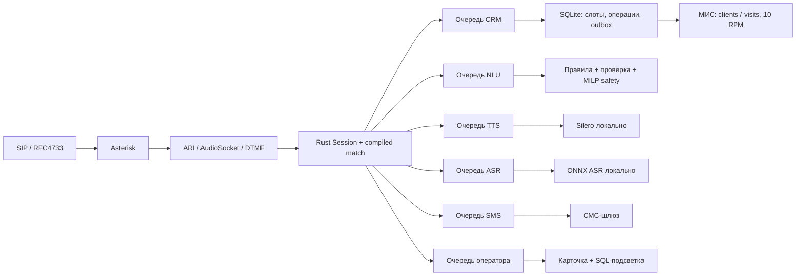

# Архитектура

`build.rs` запускает stdlib-парсер `.flow`, валидирует графы и генерирует Rust `match (flow,state)`. AST встраивается в бинарник и читается один раз. Запущенному Rust-контейнеру Python не нужен. VM не знает о сети/часах и повторяется по событиям в тестах.

На звонок приходится собственная Session, mutex, таймер, PCM-очередь и ожидаемый request_id. Сетевое ожидание одного пациента не блокирует другие звонки. Модуль имеет ограниченную очередь на 128 запросов и 4 рабочих задачи. Ответ идёт через собственный oneshot; VM дополнительно проверяет точный request_id. Дедлайн включает очередь; метрики разделяют queue_us/service_us. Переполнение отклоняется, запрос, просроченный в очереди, не исполняется.

Python сохранён для моделей, русского нормализатора, DTMF и зеркала. Это смешанная реализация с Rust-ядром, а не полный перенос всех модулей на Rust.

## Порядок записи

1. Проверка пациента, активного врача, статуса записи и будущего слота.
2. `BEGIN IMMEDIATE`: постоянная операция и резерв целевого слота.
3. Единственный адаптер расходует общий бюджет токена и обращается к МИС.
4. При подтверждении атомарно фиксируется зеркало; перенос сохраняет local/remote id.
5. Только затем объявляется успех и создаётся СМС-outbox.

Явный отказ освобождает резерв. Потерянный ответ/5xx оставляет слот заблокированным, операцию `uncertain` и заявку оператору. POST `/visits` автоматически не повторяется. Сверка после неопределённого исхода выполняется человеком; тайм-аут клиента не доказывает отмену уже начатого запроса.

## Медиа и NLU

ARI DTMF и in-band Goertzel проходят через арбитр дублей. AudioSocket UUID — 16 бинарных байтов. Управление и воспроизведение имеют независимые циклы на каждый звонок; нажатие прерывает текущий PCM. Энергетический endpoint: 600 мс тишины, максимум 10 с. ASR по умолчанию batch по репликам, не непрерывный WS-поток.

Partial API может только передать звонок человеку; изменять записи по неполной гипотезе запрещено. Клиент сообщений Deeray сохранён в calls-arena, но его непрерывный live WS-тракт не объявляется проверенным.

Медицинская/жалобная проверка MILP имеет приоритет перед «да», датой и отменой на любом шаге. Заявка оператору хранит контекст и параметризованный SQL для зелёной подсветки. В публичном снимке vars скрываются СНИЛС, дата рождения и телефоны.

`src/nlu.rs` содержит правила и символьный trie с одинаковым словарём. Оба создают параметризованный SELECT; `/v1/nlu.plan` исполняет только разрешённые SELECT-шаблоны. Это ручной автомат, не обученная модель. Основной диалог использует более полный двухступенчатый Python NLU; BGE опционален на CPU.
