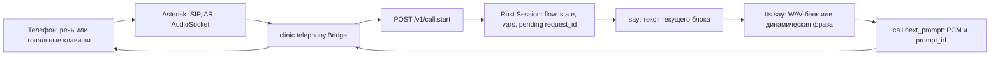
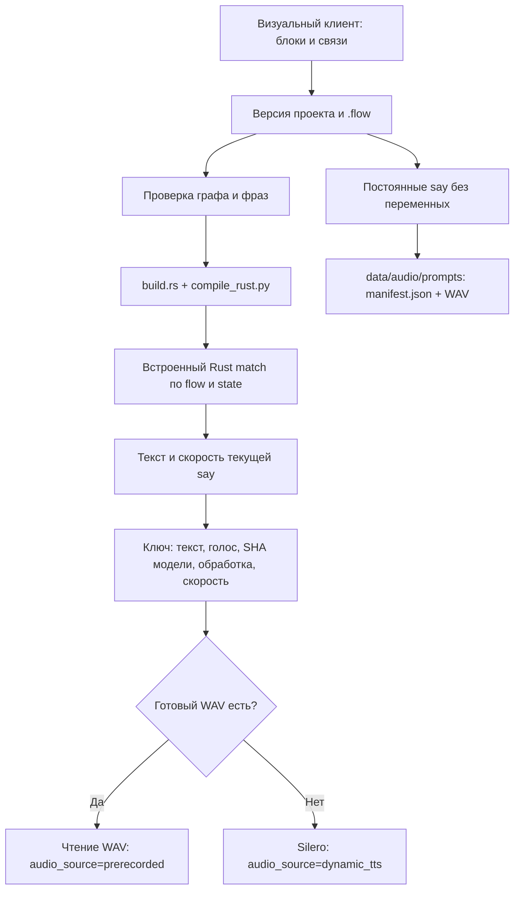
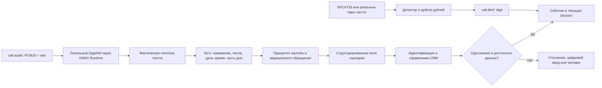
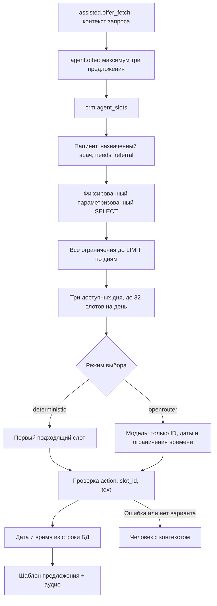
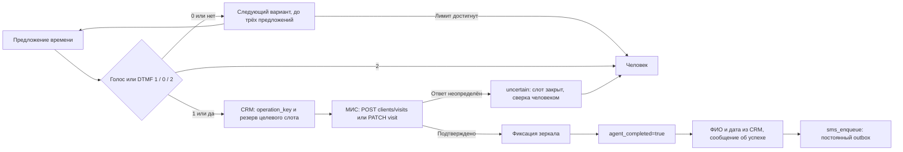
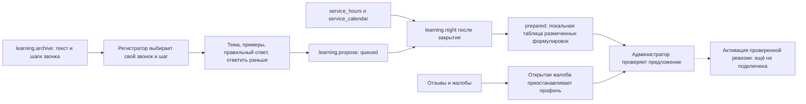

# Архитектура через один звонок и границы проверки

Помощник разделяет управление разговором, распознавание, выбор времени и запись в МИС. Положение в сценарии и данные пациента хранятся в Rust-сессии; модель выбирает только среди уже найденных слотов. Постоянные реплики воспроизводятся из WAV-банка. Дата, время и факт записи никогда не берутся из свободного ответа модели.

Описание обновлено19октября2026. Стандартный путь [assisted.flow](../scenarios/assisted.flow) прошёл три независимых режима на локальном Docker с CUDA ASR: [только речь](../debug/runs/assisted-module/speech-only/commands.json), [только реальные тоны](../debug/runs/assisted-module/tones-only/commands.json), [совместно](../debug/runs/assisted-module/combined/commands.json). Это синтетические пациенты и локальная CRM, режим выбора deterministic с0вызовов внешнейLLM. [DEBUG_WALKTHROUGH.md](DEBUG_WALKTHROUGH.md) связывает API, WAV, выбранный SQL, подтверждение и ограничения. Реальная LLM и боевые записи этим не проверены.

## 1. Позвонили: какой API принимает звонок



[Мост телефонии](../runtime/src/clinic/telephony.py) связывает SIP-канал с `call_id`, принимает бинарный UUID AudioSocket и раздельно обрабатывает управление и воспроизведение. Тот же оркестратор доступен debug-клиенту по HTTP: [src/server.rs](../src/server.rs) реализует операции `call.start`, `call.audio`, `call.dtmf`, `call.next_prompt`, `call.prompt_done`, `call.silence` и `call.hangup` за маршрутом `/v1/{op}`.

Пример начала **синтетического** звонка, который нужно включить в новый отчёт:

```json
{"call_id":"debug-standard-unique-id","flow":"assisted","caller_phone":"79165550000","registrar_number":"100"}
```

`call.start` получает `crm.meta`, создаёт собственную Session и входит в `assisted.lookup_phone`. `crm.lookup_phone` помогает найти карточку, но определённый телефон не доказывает личность. При неизвестном номере `assisted.first_visit` сначала спрашивает «Вы у нас впервые?». Далее сценарий либо передаёт вопрос регистрации человеку, либо переходит к идентификации. Известный номер также проходит шаг идентификации; информация о пациенте появляется после ответа CRM, а не из догадки модели.

В исходящих напоминаниях [reminder.identity](../scenarios/reminder.flow) сначала просит номер карты и вызывает `crm.verify_card`. ФИО, процедура, дата записи и подготовка до проверки не произносятся. Взявший трубку человек, родственник и ИИ-автоответчик не считаются пациентом автоматически. Реплика автоответчика обрабатывается как `voicemail`, без подтверждения, отмены или СМС.

## 2. Откуда бот берёт слова и готовую запись



Это отдельный «чёрный ящик сценариев»: [scenarios/](../scenarios), [компилятор](../tools/compile_rust.py), [Rust-движок](../src/engine.rs), [банк фраз](../runtime/src/clinic/audio_bank.py) и [клиент управления](../scenario-editor/src/main.jsx). Клиент использует React Flow для соединения блоков, поиск по проекту, редактирование действий и переходов, историю версий, экспорт и сборку. [Сервер редактора](../runtime/src/clinic/scenario_editor.py) сериализует изменения в `.flow`, проверяет конфликт ревизий и хранит историю. Крупный сценарий показывается ограниченными фрагментами с раскрытием соседей; полный граф доступен отдельно.

При сборке `.flow` превращается в встроенные данные узлов и `match (flow,state)`. Сотруднику не нужно вручную программировать этот `match`. Сохранение проекта, компиляция и установка новой версии — разные действия: собранный артефакт не означает автоматического переключения текущих звонков.

[Speech](../runtime/src/clinic/modules.py) при запуске TTS вызывает `PromptBank.warm`. Для постоянных `say` создаются WAV; `manifest.json` хранит исходный текст, произносимую нормализованную форму, источник `flow.state`, голос, SHA модели и параметры обработки. Стандартный каталог задаётся `PROMPT_DIR`, по умолчанию `data/audio/prompts`. Запись можно заменить настоящим WAV сотрудника с сохранением предыдущей версии.

При ответе на `tts.say` существующий WAV читается без запуска синтеза. Ответ содержит `audio_source`, `audio_key`, `audio_file`, `scenario_source`, PCM и частоту. Поэтому в debug можно показать конкретно: «текст взят из такого блока; воспроизведён такой WAV; синтез на этом ответе не вызывался». Статические фразы следует подготовить заранее, чтобы при каждом звонке не тратить вычисления.

Реплика вида `{patient_name}, вы записаны на {slot_date_spoken}` зависит от пациента. Текущий код синтезирует её локально и не сохраняет в постоянный общий банк. Разрезание всех возможных имён и дат на куски здесь не заявляется реализованным. [Нормализатор TTS](../runtime/src/calls/tts/normalize.py), [словесные даты/время](../runtime/src/calls/tts/verbalize.py), [ударения](../runtime/src/calls/tts/stress.py) и [обработка звука](../runtime/src/calls/tts/processing.py) работают перед воспроизведением.

[Контроль выпуска аудио](../runtime/src/clinic/audio_release.py) требует актуального успешного аудита каждой постоянной фразы, включая совпадение модели, обработки и SHA WAV. Старый отчёт или изменение записи после проверки не подтверждают готовность нового банка. ASR и проверка сигнала не доказывают приятность голоса — для этого сохранены слышимые образцы.

## 3. Речь, цифры, даты и фамилии — отдельный модуль



[OnnxAsrModule](../runtime/src/calls/asr/onnx_gateway.py) получает звук, а не ожидаемую расшифровку теста. [NLU](../runtime/src/clinic/modules.py) соединяет русский [нормализатор](../runtime/src/calls/nlu/normalize.py), классификацию/проверку и слой безопасности MILP. Например, сказанное «завтра после обеда» должно стать `said_date` и `said_daypart`; номер карты по одной цифре — цифровой последовательностью для поиска. Выбор слов и распознавание не изменяют запись сами по себе.

Для фамилий нужна отдельная проверка: распознать звучание, сопоставить со справочником, показать совпадения и уточнить неоднозначность. Для пациента в текущем стандартном пути используется номер карты; свободная фамилия не заменяет проверку личности. Запрос конкретного врача по фамилии в существующих правилах может уйти человеку. **Надёжная автоматическая запись по сложным русским и иностранным фамилиям ещё не доказана.** Примеры вроде «Шварценеггер», «О’Коннор», «Нгуен» должны получить собственные WAV, фактические гипотезы ASR и результат сопоставления БД; перечисление имён в документации не является таким тестом.

Тональный путь независим: [детектор](../runtime/src/calls/dtmf/inband.py) и [арбитр](../runtime/src/calls/dtmf/arbiter.py) принимают настоящие пары частот или события телефонии. Действие определяется текущим блоком; одна и та же цифра не имеет глобального значения во всех сценариях. В `assisted.offer`: `1` — принять время, `0` — следующее предложение, `2` — человек. В напоминании есть собственное меню. Неполная гипотеза `call.partial` может вызвать безопасную эскалацию, но не запись/отмену.

## 4. Малый агент: запрос к данным, выбор и произносимая фраза



[SlotAgent](../runtime/src/clinic/agent.py) вызывает [planner_store.slots](../runtime/src/clinic/planner_store.py) через `crm.agent_slots`. SQL — утверждённый шаблон приложения. В него подставляются связанные параметры; ни исходная фраза пациента, ни SQL модели не исполняются. Для проверки отдельного небольшого автомата существует также `/v1/nlu.plan` из [src/nlu.rs](../src/nlu.rs): это самостоятельная read-only демонстрация правил/trie, а не тот же путь, что `agent.offer`.

Порядок отбора важен: свободный будущий слот, активный врач, специальность, назначенный врач, направление, дата, часть дня, минимальное время и исключённые ранее ID фильтруются **до** определения трёх ближайших доступных дней. Иначе три утренних дня скрыли бы подходящий вечер четвёртого дня. Назначение читается из `patient_assignments`; отсутствие строки означает поиск по специальности, а не доказанную привязку к участку. Требование направления берётся из `doctors.needs_referral`, без перечня специальностей в коде. Источник действительного направления для пациента и передача доверенного подтверждения сценарием остаются интеграционной работой.

Модель не получает расписание «врач работает с15до17», всю картотеку или стенограмму. Для выбора ей достаточно возвращённых ID и дат слотов плюс нормализованных ограничений. ФИО, телефон, дата рождения, СНИЛС и `patient_id` в облачный payload не входят. Ключ OpenRouter читается локально из переменной или файла секрета; его нет в сценарии или debug-отчёте. По умолчанию работает детерминированный режим — это явно отличается от вызова LLM.

Модель отвечает только `{action, slot_id, text}`. `offer` обязан ссылаться на существующий целочисленный ID; `operator` — иметь `slot_id=null`; `text` в обоих случаях должен быть строкой ограниченной длины. Даже корректный `model_text` не становится голосовой правдой. `agent_text`, `slot_date_spoken` и `slot_time_spoken` строятся по выбранной строке БД. Так модель может помочь выбрать время, но не может выдумать дату или заявить о выполненной записи.

Общий бюджет агента —24с, включая CRM до5с и максимум две попытки проверки JSON-контракта до8с каждая. Транспортные ошибки, таймауты и ошибки провайдера возвращаются явно; успешная детерминированная подстановка вместо сбоя модели не используется. Срок ожидания ответа не гарантирует отмены уже отправленного внешнего запроса. Подробный локальный контракт и официальные источники API — [debug/runs/slot-agent/contract.md](../debug/runs/slot-agent/contract.md). Сохранённые тесты используют fixtures, настоящий OpenRouter ими не вызывался.

## 5. Согласие, запись, СМС и состояние результата



[Session](../src/engine.rs) хранит имя текущего блока, переменные пациента, выбранное время, число предложений, исключённые ID, историю шагов и ожидаемый ответ модуля. [Сервер](../src/server.rs) добавляет ключ операции из звонка и запроса. [Шина](../src/bus.rs) использует ограниченные очереди, отдельные ответы и дедлайны; Session проверяет `request_id`, чтобы старый ответ не продолжил уже изменившийся шаг.

В `assisted.book` вызывается `crm.book`. [ClinicCrm.mutate](../runtime/src/clinic/crm.py) проверяет пациента/врача/слот, сохраняет намерение и резерв до сети, обращается к адаптеру МИС и только после подтверждения фиксирует результат. Перенос сохраняет идентификатор прежней записи и освобождает старый слот после успеха. Потерянный ответ не означает, что МИС ничего не сделала: слот и операция попадают в карантин, без автоматического повторного POST.

Только ветка `ok` ведёт в `assisted.success`, где устанавливается `agent_completed=true`, произносится подтверждение и вызывается СМС. [Sms](../runtime/src/clinic/modules.py) сначала сохраняет outbox через `sms_enqueue`, затем отправляет шлюзу с ключом идемпотентности. `queued`, `accepted` и `simulated` различаются: демонстрационная СМС не является доставленным сообщением на реальный телефон.

После успеха явное возражение ведёт к человеку. «Да»/благодарность, отсутствие ответа и вопрос «Нужно ли вам что-нибудь ещё?» описаны в `assisted.success`/`assisted.ask_more`. Эти переходы присутствуют в исходнике; новый единый аудиопрогон должен отдельно подтвердить их фактическое выполнение.

## 6. Человек, очередь и возможность поспать

При передаче модуль `operator.transfer` вызывает `crm.operator_transfer` и сохраняет [OperatorTicket](../runtime/src/calls/crm/operator.py). В нём есть идентификатор звонка, причина, найденный пациент/запись, ограничения, история шагов, последняя переданная реплика, SQL-подсветка и расписание. Представление доступно через `/operator`; [мастерская](../scenario-editor/src/RegistrarWorkshop.jsx) отдельно открывает текстовый архив звонка по своему рабочему месту.

Заявка оператору сохраняет точный `machine_view`: исходный `agent_sql`, связанные параметры, исходные слоты, выбранный ID и число предложений. Поле `dialogue` содержит фактические реплики Rust. Этот снимок не пересчитывается и не исполняет произвольный SQL; отдельный предпросмотр БД не выдаётся за первоначальный экран модели. После3отказов равенство снимка проверено настоящими речью/тонами. Текущее место и минуты ожидания без операционных данных не выдумываются.

Позиция в очереди и ожидаемые минуты должны считаться по настоящим данным телефонной очереди и доступности сотрудников. Текущий билет не является такой моделью ожидания; выдуманные место и минуты не озвучиваются. Подготовленная фраза перевода и сам перевод могут проверяться независимо от будущего расчёта очереди.

Общее расписание сотрудников находится в [hours.py](../runtime/src/clinic/hours.py): `service_hours` и исключения `service_calendar`. При недоступном операторе неэкстренная эскалация переходит в [callback.flow](../scenarios/callback.flow), спрашивает удобные день/время и вызывает `crm.callback_request`. Запрос проверяет будущее время и часы работы, сохраняет заявку и контекст. Экстренная ветка не ждёт следующего рабочего дня. Автоматическое исполнение обратных звонков и реальная доступность телефонного оператора требуют отдельной проверки телефонии; сохранение заявки не доказывает состоявшийся перезвон.

## 7. Очередь на приём и подготовка — другой вид ожидания

[WaitingQueue](../runtime/src/clinic/queueing.py) хранит обращения, согласие на раннее приглашение и предложения освободившихся слотов. Это календарные дни до визита, а не секунды дозвона и не очередь живого оператора. [Исследование](research/WAITING_TIME.md) объясняет необходимые даты, медиану/p75 и незавершённые обращения. Данных для реального среднего по конкретной клинике пока недостаточно; норматив ПГГ не выдаётся за измеренное среднее региона. Магас указан как город организаторов, название клиники взято из условного регламента.

Кандидаты идут от ближайших более поздних записей к согласившейся очереди без талонов. Предложение имеет устойчивый `offer_id`, срок действия и блокировку конкуренции; отказ сохраняет прежнюю запись, подтверждённое согласие одного прекращает кампанию. Неопределённое изменение МИС требует сверки. Повторные кампании того же слота, восстановление после сбоя и подключение к общему обзвону остаются открытыми.

[Каталог подготовки](../data/preparation/catalog.json) содержит источники и черновики отдельных процедур. Он выключен до клинического утверждения. Разрешение требуется каталогу и конкретной записи, с датой пересмотра; просроченная или неутверждённая памятка не отдаётся для произнесения и не разрешает приглашение. Флаг пациента «я подготовился» не обходит минимальный интервал. LLM не сочиняет диету, лекарства или разрешение на процедуру. В действующий голосовой путь ещё нужно передать точную услугу, версию инструкции и подтверждённую готовность.

## 8. Человеческая разметка и ночные изменения



[Learning](../runtime/src/clinic/learning.py) проверяет принадлежность звонка рабочему месту и наличие выбранного шага в истории. Сотрудник добавляет собственные примеры, корректную тему/ответ и при необходимости более ранний шаг. Ночная обработка формирует отчёт по нормализованным размеченным формулировкам: это локальное обучение на примерах, **не обучение весов нейросети**.

[Ночной worker](../runtime/src/clinic/nightly.py) независимо вызывает `learning.night` и `nightly.run`; CRM использует то же расписание закрытия, что и обратные звонки. [Insights](../runtime/src/clinic/insights.py) отдельно хранит отзывы, жалобы и задачи кластеризации. Звёзды не вычисляются из тональности: отдельная средняя учитывает только явно названные числа. Жалоба атомарно приостанавливает профиль своего номера. Одобрение администратором оставляет профиль черновиком до отдельного проверенного развёртывания. Кластеризация свободных отзывов также не является расчётом срока ожидания врача.

Персональная версия со следующего дня, ограниченная номером автора, сроком действия и откатом — требуемый следующий этап. Сейчас `learning.review` прямо блокирует утверждение в работу, потому что развёртывание персональных ревизий не подключено. [Браузерный отчёт мастерской](../debug/runs/workshop/browser/result.json) подтверждает сохранение предложения и ограничения ролей; `activation_claimed=false` сохраняет эту границу явно.

## 9. Границы модулей и смена МИС

| Модуль | Основной код/операции | Данные и ответственность |
| --- | --- | --- |
| Сценарии и состояние | [engine.rs](../src/engine.rs), `.flow` | Текущий шаг, собранные поля, допустимые переходы, контекст и корреляция |
| Телефония | [telephony.py](../runtime/src/clinic/telephony.py) | ARI/AudioSocket, звук, DTMF, начало и завершение воспроизведения |
| Аудиобанк/TTS | [audio_bank.py](../runtime/src/clinic/audio_bank.py), `tts.say/synth`, `bank.*` | Подготовленные WAV, динамические фразы, замена и аудит |
| ASR/NLU | [onnx_gateway.py](../runtime/src/calls/asr/onnx_gateway.py), `transcribe`, `interpret` | Фактическая гипотеза речи и нормализованные поля; без записи в МИС |
| Ограниченный агент | [agent.py](../runtime/src/clinic/agent.py), `agent.offer` | Выбор известного слота, ограничение попыток и ответа |
| CRM/МИС | [crm.py](../runtime/src/clinic/crm.py), `book/cancel/reschedule/confirm` | SQL-шаблоны, зеркало, резерв, идемпотентность и подтверждённые изменения |
| Оператор/СМС | `operator_transfer`, `sms_enqueue/pending/ack` | Постоянные заявки и outbox; доставка отделена от постановки в очередь |
| Управление | [scenario_editor.py](../runtime/src/clinic/scenario_editor.py), [клиент](../scenario-editor/src/main.jsx) | Визуальный проект, роли, история, проверка и сборка |
| Разметка и аналитика | `learning.*`, `feedback.*`, `nightly.run`, `waiting.*` | Архив, человеческие примеры, ночные задания, измерение ожидания |

Действующий адаптер `StrictStand` сохраняет контракт стенда `/clients` и `/visits` с общим лимитом10 запросов в минуту. Зеркало обслуживает чтения локально. Смена адреса через конфигурацию не равна безопасной смене медицинской системы: нужно изолировать локальные/удалённые ID, незавершённые операции, токены и outbox, проверить новый адаптер и выполнить миграцию. Полная замена МИС из админки пока открыта; имеющиеся статус и настройки не объявляются законченным переключателем.

## 10. Какие доказательства уже существуют в debug

Результаты генерируются в `debug/runs/` и исключены из Git; в Git остаются команды, входы и тесты. Ссылки ниже открываются в рабочем пространстве либо после получения соответствующего артефакта CI. Каждый отчёт относится к своему голосу, исходникам и дате: старый успешный файл не подтверждает новую сборку.

| Проверяется отдельно | Скрипт или вход | Фактические результаты и предел вывода |
| --- | --- | --- |
| Только настоящие тоны | [run_dtmf_commands.py](../debug/run_dtmf_commands.py) | [dtmf-only/commands.json](../debug/runs/dtmf-only/commands.json): PCM/A-law/μ-law, независимые команды; ASR-входов нет |
| Только речь | [run_speech_commands.py](../debug/run_speech_commands.py) | [speech-only/commands.json](../debug/runs/speech-only/commands.json): WAV→ASR→inbound/reminder, без тонов; это ещё не новый assisted-путь |
| Речь и клавиши вместе | Тот же скрипт с `--mode combined` | [combined/commands.json](../debug/runs/combined/commands.json): самостоятельный комбинированный прогон прежних сценариев |
| Неизвестный ответивший/ИИ-автоответчик | [run_unverified_recipient.py](../debug/run_unverified_recipient.py) | [answering-machine/commands.json](../debug/runs/answering-machine/commands.json): фактический звук и запрет действий до идентификации |
| Человек недоступен | [run_callback.py](../debug/run_callback.py) | [callback/commands.json](../debug/runs/callback/commands.json): вопрос времени, сохранение заявки и экстренная ветка; без доказательства внешнего перезвона |
| Числа/даты и качество фраз | [run_speech_quality.py](../debug/run_speech_quality.py) | [tts-quality/verified/result.json](../debug/runs/tts-quality/verified/result.json): реальный ASR и WAV48/8кГц; [последующая проверка политики](../debug/runs/tts-policy-audit/result.json) отдельно показывает оценку сохранённого материала |
| Чтение готового WAV | [run_audio_bank.py](../debug/run_audio_bank.py) | [audio-bank/result.json](../debug/runs/audio-bank/result.json): старый отдельный тест повторного использования; SHA модели отличается от нового verified-голоса |
| Браузерный граф и воспроизведение | [run_editor_reading.mjs](../debug/run_editor_reading.mjs), [run_voice_controls.mjs](../debug/run_voice_controls.mjs) | [editor-reading/result.json](../debug/runs/editor-reading/result.json), [voice-controls/result.json](../debug/runs/voice-controls/result.json): интерфейс и реальные аудиокнопки, без доказательства всего звонка |
| Выбор слотов/SQL/схема модели | [test_slot_agent.py](../tests/integration/test_slot_agent.py) | [slot-agent/summary.json](../debug/runs/slot-agent/summary.json): локальная БД и fixtures ответов; настоящих вызовов LLM нет |
| Конкуренция очереди/подготовка | [test_waiting_queue.py](../tests/integration/test_waiting_queue.py) | [waiting-queue/summary.json](../debug/runs/waiting-queue/summary.json): транзакции и локальный МИС-контракт, без обзвона и голоса |
| ARI и AudioSocket | [run_asterisk_contract.py](../debug/run_asterisk_contract.py) | [containers/asterisk-contract.json](../debug/runs/containers/asterisk-contract.json): соединения и UUID, реальных телефонных вызовов не совершалось |
| Новый стандартный звонок | [inputs/assisted-booking.json](../debug/inputs/assisted-booking.json) | [assisted-module/](../debug/runs/assisted-module/): три независимых режима прошли, WAV/состояния/SQL/CRMрезультат сохранены |

Команды запуска и требования к окружению — в [debug/README.md](../debug/README.md). Послушать сохранённые примеры можно через [debug/listen.html](../debug/listen.html); страница с WAV не заменяет проверку исполнения команды. Открытые обязательства и условия общей приёмки остаются в [TODO.md](../TODO.md) и [GOAL.md](acceptance/GOAL.md).

## Защищённые отзывы и ночная сводка

Администратор открывает «Отзывы». Сервер редактора получает роль из своей сессии и подписывает только разрешённые операции сводки/разрешения жалобы/одобрения черновика. CRM проверяет HMAC, срок30с и одноразовый nonce; роль из браузерного JSON не принимается. Внутренний ключ32байта создаётся автоматически в отдельномDockerтоме, смонтированном только CRM и редактором для чтения. Он не является паролем пользователя, не печатается и не хранится в Git. Наблюдатель и регистратор доступа к этой панели не получают. [insights_access.py](../runtime/src/clinic/insights_access.py), [FeedbackPanel.jsx](../scenario-editor/src/FeedbackPanel.jsx).

После явного подтверждения итоговых данных сценарий может спросить «Что исправить в тестовом варианте?». Отзыв сохраняется свободным текстом, ночная задача ждёт закрытия по общей реляционной таблице часов. Благодарность завершает обычный путь без дополнительного опроса. Полная активация персональных сценариев, боевой обзвон и оценка эффекта правок остаются в TODO.
