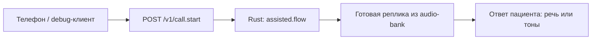
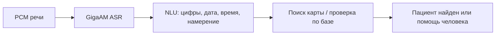
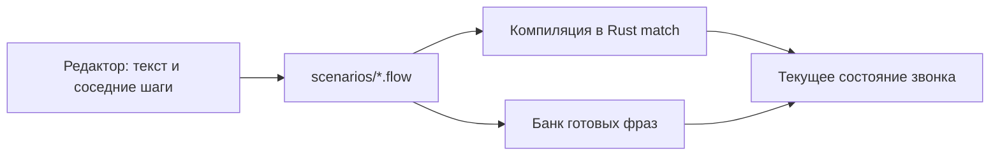
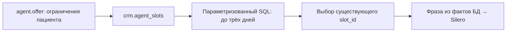
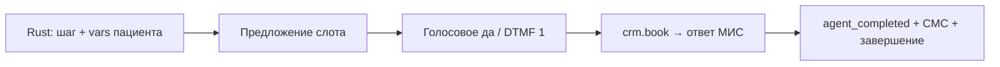

# Один звонок: от аудио до подтверждённой записи

Стандартный пример этого документа — явно выбранный `flow=assisted`. Он отличается от исходного входящего меню `flow=inbound` и от микрофонной песочницы наблюдателя. Пример использует локальное демонстрационное расписание, карту `1003` и детерминированный выбор слота. Доступность платной LLM и запись в настоящую поликлинику этим примером не подтверждаются.

## Вход, сценарий и готовая реплика



На локальном стенде API принимает запрос:

```bash
curl --fail http://localhost:8080/v1/call.start \
  -H 'Content-Type: application/json' \
  -d '{"call_id":"readme-example","flow":"assisted","caller_phone":"79165550000","registrar_number":"100"}'
```

В live дополнительно нужен заголовок авторизации, настроенный локально. Пример выше предназначен для demo. `caller_phone` используется для поиска, но сам по себе не удостоверяет пациента. При незнакомом номере сценарий сначала спрашивает «Вы у нас впервые?». В стандартных тестовых данных известный номер ведёт к вопросу о карте: пациент произносит «один ноль ноль три» или вводит `1003#`. `crm.find_patient` ищет карту в базе; неоднозначный результат не разрешает запись.

Текст вопроса хранится в [scenarios/assisted.flow](../scenarios/assisted.flow), состояние `identify`. Во время подготовки банка Silero заранее озвучивает статические `say`. [audio_bank.py](../runtime/src/clinic/audio_bank.py) выдаёт совпавшую запись из тома `audio-bank`, каталог `/audio`, а не вызывает модель на каждом звонке. `current.json` перечисляет активные ключи. Банк проверяется реальным ASR до допуска версии.

Клиент получает следующий звуковой фрагмент через `POST /v1/call.next_prompt` с `call_id`. В ответе есть PCM и происхождение: `audio_source=prerecorded`, `scenario_source`, `audio_key`. В debug эти поля сохраняются рядом с WAV. Если фраза содержит выбранные дату/время или имя, она собирается из подтверждённых данных и синтезируется отдельно: `audio_source=dynamic_tts`. Постоянные подсказки «один — подходит, ноль — другое время, два — оператор» остаются в банке.

## Распознавание и установление пациента



`POST /v1/call.audio` получает PCM16 в `pcm_b64` и частоту в `rate`. Он передаёт настоящий звук в ASR, затем текст — в NLU. Номер карты читается по цифрам; дата и время становятся отдельными ограничениями поиска. В режиме GPU GigaAM выполняет нейронные операции на CUDA; проверка реальных профилей описана в [LOCAL_GPU.md](LOCAL_GPU.md).

Тоновый путь самостоятельный: телефонный мост распознаёт DTMF из PCM и передаёт `POST /v1/call.dtmf`. Кнопка подтверждения действует в текущем вопросе сценария. В тесте тонов ASR не подменяет детектор, в речевом тесте нет скрытых нажатий.

Идентификация по сложной или иностранной фамилии пока не принята как самостоятельный сквозной маршрут. Демонстрация использует карту и проверку базы. Для произнесения фамилии Silero требуется проверенное ударение, для латиницы — явное русское произношение; неизвестное произношение отвергается, а не угадывается. Проверенные примеры и ограничения: [SPEECH_QUALITY.md](SPEECH_QUALITY.md). Не следует считать совпадение ASR достаточным удостоверением личности.

## Сценарии как отдельный модуль



Исполняющая часть получает событие и данные, выбирает следующую ветку и возвращает реплику/действие. Внутренние переходы и SQL не нужно вводить регистратору. Мастерская показывает звонок и соседние шаги; администратор управляет полным сценарием, проверкой и выпуском версии. Адреса и роли:

| Адрес | Назначение | Начальный вход |
| --- | --- | --- |
| `http://localhost:8090/registrar` | Мастерская и отдельный микрофонный пробный звонок | `user/user`; наблюдатель без пароля |
| `http://localhost:8090` | Администрирование сценариев и фраз | `admin/admin` |
| `http://localhost:8080/operator` | Контекст переданного обращения | Авторизация API в live |

Микрофонный пробный звонок наблюдателя — отдельная песочница категорий: участковый, специалист, исследования/анализы. Он показывает распознавание и маршрут, но не создаёт запись в МИС. [Его API и границы](OBSERVER_CALL.md). Работа с предложением исправления: [WORKSHOP.md](WORKSHOP.md). Ночное применение и измерение эффективности персональных правок имеют отдельные условия приёмки, их нельзя считать выполненными по наличию редактора.

## Текстовый выбор и доступные действия



После вопроса о специалисте Rust вызывает `agent.offer`. [planner_store.py](../runtime/src/clinic/planner_store.py) содержит фиксированный SQL, а не выполняет текст, придуманный моделью. Сначала применяются специальность, прикреплённый врач при наличии, проверенное направление, дата/время, часть дня и исключённые предложения. Затем выбираются ближайшие **три дня, где остались подходящие свободные места**, до 32 слотов на день. Примерные категории действий: прочитать данные, создать подтверждённую запись, изменить существующую запись. Операции записи выполняет CRM по известному контракту.

Стандартный `AGENT_MODE=deterministic` выбирает первый допустимый слот без внешней модели. Поддержаны `AGENT_MODE=openai` для совместимого шлюза и `AGENT_MODE=openrouter`. Их ключи, модель и адрес задаются локально через `.env`/файл ключа; значения не публикуются. Для OpenAI-совместимого шлюза используются `OPENAI_BASE_URL`, `OPENAI_API_KEY` или `OPENAI_API_KEY_FILE`, `OPENAI_MODEL`; для OpenRouter — соответствующие `OPENROUTER_API_KEY`, `OPENROUTER_API_KEY_FILE`, `OPENROUTER_MODEL`.

Внешний выбор получает только доступные идентификаторы/время и нормализованные ограничения. Выход ограничен схемой `action`, `slot_id`, `text`, существование слота проверяется. ФИО, телефон и произвольный SQL в этот запрос не отправляются. Даже принятую моделью фразу нельзя использовать для выдумывания времени: пациенту произносится каноническая фраза из выбранного слота БД. Ошибки контракта имеют ограниченное число повторов; недоступность провайдера не маскируется успешным вызовом LLM. Реальный платный запрос требует отдельно настроенного ключа и отдельного доказательства.

Важная граница DBI: в опубликованном API нет маршрута получения полного расписания свободных талонов. Поэтому live читает импортированное расписание с явными `doctor_id` стенда и синхронизированные визиты. После синхронизации срок свежести составляет **пять минут**; при отсутствии/истечении синхронизации агент не предлагает слоты. Получение списка врачей не доказывает актуальности расписания. [Контракт и настройка стенда](STAND.md).

## Данные пациента и подтверждение записи



У каждого звонка свой `call_id`, текущее состояние, карта/идентификатор пациента, ограничения, уже предложенные слоты и число предложений. Состояние запрашивается через `POST /v1/call.state` с `call_id`. Поля `agent_sql`, `agent_sql_params`, `agent_seen_slots`, `agent_selection` сохраняют то, на основании чего машина выбрала время.

До подтверждения `agent_completed=false`: предложение и отказ не создают запись и не отправляют СМС. «Да» или `1` вызывает `crm.book`. Только подтверждённый успех переводит автомат в `success`, ставит `agent_completed=true`, сообщает имя и время, создаёт СМС. В demo это локальный стенд и имитация доставки; live требует подтверждения DBI и настроенного СМС-провайдера. Потерянный ответ не считается успешной записью.

После итоговой реплики «нет» или `0` означает спор с результатом и ведёт к человеку; «да»/«спасибо» завершает звонок. Если ответа нет, автомат отдельно спрашивает, нужна ли ещё помощь, затем завершает по «нет»/«спасибо» или повторному таймауту. Тестовый сценарий не заменяет голос тишиной: естественный таймер используется только для проверки поведения после окончания настоящей реплики.

## Три отказа и тот же экран у оператора

Первое предложение и ещё две альтернативы дают максимум три предложения. Отказы не записывают пациента и исключают уже отвергнутые слоты. После третьего отказа дальнейший выбор прекращается.

Оператор получает историю и зафиксированный `machine_view`: SQL-шаблон, параметры, показанные слоты, выбранный идентификатор, число предложений и режим выбора. Это данные того же шага, а не новый поиск при открытии страницы. При доступном сотруднике оформляется передача; позиция/оценка ожидания должны иметь источник, отсутствующее время не выдумывается. Заявка в интерфейсе сама по себе не доказывает реального соединения по SIP — оно проверяется отдельно через Asterisk.

Вне рабочего времени робот продолжает доступные операции. Если требуется человек, проверяется расписание регистратуры из БД, задаётся вопрос об удобном времени обратного звонка и создаётся заявка. Прогон с `--operator-unavailable` проверяет именно `callback.ask`, а не считает его выполненной передачей сотруднику.

## Воспроизвести и прослушать

Запустите локальный GPU-стенд: `./clinic start --gpu`. Прогоны ниже **изменяют только demo-базу**, создают тестовую запись и сверяют снимки CRM. Используйте отдельный демонстрационный стенд; `flow=assisted` не является разрешением запускать приёмку на реальных пациентах.

```bash
python debug/run_assisted_commands.py --mode speech-only \
  --output-dir debug/runs/assisted-module/speech-only
python debug/run_assisted_commands.py --mode tones-only \
  --output-dir debug/runs/assisted-module/tones-only
python debug/run_assisted_commands.py --mode combined \
  --output-dir debug/runs/assisted-module/combined
```

Эти команды ожидают доступного оператора в отрицательной ветке. Для стенда вне рабочего времени добавьте `--operator-unavailable` и сохраните результат в отдельную папку, например `debug/runs/assisted-module/off-hours`.

| Вход | Отчёт | Что проверяет |
| --- | --- | --- |
| Только речь | [speech-only/commands.json](../debug/runs/assisted-module/speech-only/commands.json) | Настоящий Silero → PCM → ASR, запись после согласия и три голосовых отказа |
| Только тоны | [tones-only/commands.json](../debug/runs/assisted-module/tones-only/commands.json) | Синтез DTMF → production-детектор → автомат; без речевых входов |
| Совместно | [combined/commands.json](../debug/runs/assisted-module/combined/commands.json) | Речь и распознанные тоны в одном звонке |

У каждой папки есть `audio/caller`, `audio/tones`, `audio/bot` по используемому режиму. Отчёт связывает WAV, входное событие, состояние, источник реплики, снимки записей до/после и итог передачи. Источник теста: [debug/run_assisted_commands.py](../debug/run_assisted_commands.py). 19.10.2026 все три режима прошли на локальном Docker с CUDA ASR: speech-only —9речевых/0тоновых, tones-only —0речевых/17тоновых, combined —3речевых/14тоновых. В каждом подтверждена запись только после согласия и отсутствие записи после трёх отказов; результат конкретного повторного запуска устанавливают `status` и содержимое отчёта; неуспешный прогон сохраняет `failed-progress.json`. Эти прогоны используют `model_calls=0`; они не являются проверкой внешней LLM или реальной клиники.

Состав всех модулей и оставшиеся условия: [GOAL.md](acceptance/GOAL.md), [TODO.md](../TODO.md). Рабочая демонстрация одного пути не означает полного выполнения исходного ТЗ.
