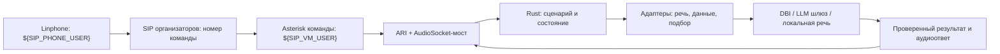
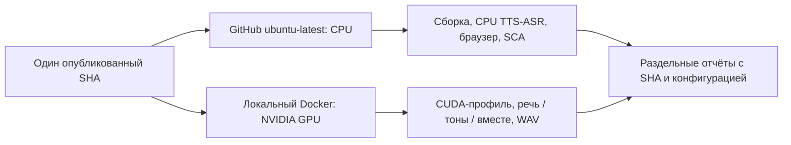

# Текущая архитектура и целевая интеграция команды

Срез конфигурации и адаптеров: **21 октября 2026 года**. Параметры подключения задаются локально по памятке команды; конкретные адреса и логины здесь не публикуются. Это параметры целевого подключения, а не отчёт об успешном развёртывании. Документ не выполняет сетевые проверки и не содержит секретов.

Основная проверяемая поставка — локальные Docker-контейнеры. VM и Gitea образуют отдельный путь публикации; их недоступность не должна отключать локальный GPU. Изменения сценариев и реплик проверяются отдельно: схема описывает границы модулей и не утверждает, что все ветки регламента уже реализованы.

## 1. Что работает сейчас и куда должно подключаться

| Граница | Текущая реализация | Требуемое подключение и предел доказательства |
|---|---|---|
| Локальный клиент | Редактор и мастерская: `http://localhost:8090`, API: `http://localhost:8080`. Compose публикует оба порта только на `127.0.0.1`. | `./clinic status` показывает фактические адреса. Эти адреса не являются публичным демо VM. |
| Публичное демо | Готового публичного входа `0.0.0.0:8000` в основном `compose.yaml` нет. | VM: `${DEPLOYMENT_URL}`; вход на хосте должен слушать `0.0.0.0:8000`. Нужен отдельный proxy/override с проверкой браузера и API. |
| GitHub | Ветка `feature/rust-clinic-voice` в `Emilka135/MILP-ops`; проверки запускаются на опубликованный SHA. | Зелёный GitHub не означает сдачу в Gitea или установку на VM. Результат проверяют для конкретного SHA. |
| Gitea | Публикация на сервере организаторов не подтверждена. | `${DEPLOYMENT_URL}`, ветка сдачи `main`. После публикации сверяют SHA; пароль не помещают в URL. |
| Подбор слотов | По умолчанию `AGENT_MODE=deterministic`: выбор из разрешённых результатов SQL без внешнего LLM-вызова. | Шлюз `${OPENAI_BASE_URL}`; нужны локально настроенные ключ и ID модели. Успех фикстуры API не доказывает живой вызов. |
| DBI | `StrictStand`, изолированное демо, фиксированные операции записи, зеркало и журнал неопределённых результатов. Ранее сохранено чтение справочника HTTP 200; живая запись им не проверена. | `APP_MODE=live`, `STAND_URL=${STAND_URL}`, `DBI_API_TOKEN` либо `STAND_TOKEN`. Нужны настоящее расписание и проверенные сопоставления пациентов/врачей. |
| SIP | Локальный Asterisk, ARI/AudioSocket-мост и контрактный прогон. Локальный dialplan использует номер `100`, учётки `phone`/`operator`. | Выдан **ограниченный командный контур**, учётки `${SIP_VM_USER}` и `${SIP_PHONE_USER}`. Конфигурацию нужно согласовать с памяткой VM; живой звонок ещё не принят. |
| Эскалация | Локальная заявка с историей и снимком слотов; мост умеет ARI continue в `clinic-operator`. | `POST /escalations` в DBI пока не подключён. Регистрация заявки, перевод SIP-канала и ответ сотрудника — три разных результата. |
| SMS | Адаптер с настраиваемым шлюзом; локальный результат не доказывает доставку абоненту. | Нужны `SMS_GATEWAY_URL` и локальный токен, затем подтверждение доставки. Учётки SIP не являются SMS-шлюзом. |

Исторические результаты: [VALIDATION.md](VALIDATION.md), [STAND.md](STAND.md), [DEBUG_WALKTHROUGH.md](DEBUG_WALKTHROUGH.md). Новая памятка уточняет доступность инфраструктуры, но не заменяет её приёмку.

## 2. Текущий путь одного звонка

Речь проходит `ASR → NLU`, тон — `RFC4733 / in-band detector → арбитр DTMF`. Оба становятся событиями текущего состояния Rust; один тон не имеет универсального действия во всех меню. Постоянный текст берётся из `scenarios/*.flow`, при компиляции становится встроенным `match`, а WAV — из тома `audio-bank`. Дата, время и пациент берутся из проверенных данных, а не свободной фразы LLM.

Запись требует явного согласия и успешного результата CRM. При потере ответа внешней МИС операция остаётся `uncertain`, слот не выдаётся повторно автоматически. Оператор получает диалог и зафиксированный `machine_view`; открытие страницы не исполняет сохранённый SQL заново.

Браузерный пробный звонок наблюдателя — самостоятельная песочница (`demo_call.py`, `sandbox_store.py`) с синтетической картотекой. Он использует речевые модули, но не доказывает прохождение телефонного Rust-сценария или запись в DBI. Снимок правил звонка сохраняется отдельно от последующих правок.

## 3. Целевая схема у организаторов

Второй рисунок — требуемый вход публикации, а не установленный reverse proxy. HTTP-интерфейс не заменяет SIP-тракт. Администратор и регистратор проходят свою авторизацию; наблюдатель может сделать пробный звонок и открыть детализацию, но не менять сценарий. За HTTPS-прокси требуется настройка защищённой cookie (`EDITOR_SECURE_COOKIE=1`) и проверка авторизации/CSRF на реальном адресе.

### VM и сдача кода

Рабочая папка VM — `~/project`; вход — по SSH-команде из локальной памятки организаторов. Пароли бастиона и команды скрыты в выданном тексте. Для этой документации подключение не требуется и не выполняется.

По памятке `OPENAI_BASE_URL`, `OPENAI_API_KEY`, `DBI_API_TOKEN` находятся на VM в `/opt/hackathon/ai.env`. Окружение хоста не передаётся в Docker автоматически: Compose явно передаёт выбранные имена. Проверяют наличие настроек и результат запроса без печати значений. Нельзя сохранять развёрнутый `docker compose config` публичным артефактом: в нём могут оказаться ключи.

`HTTP_PORT=8000` меняет номер порта оркестратора, но сохраняет `127.0.0.1`: это **не** выполняет требование публичного `0.0.0.0:8000` и не публикует мастерскую. Перенос порта редактора имеет ту же границу. Вход выбирают явно и проверяют браузером, не открывая внутренние CRM/ASR/TTS-порты.

Публикация в GitHub и `git push` в Gitea независимы. В Gitea отправляется проверенный код без `.env`, весов, приватных ключей и архивов данных. Сборку, публичный URL и сохранность томов после перезапуска проверяют на VM.

### SIP команды

| Сторона | Выданные параметры | Что нужно подтвердить |
|---|---|---|
| Linphone | UDP, сервер `${SIP_PHONE_HOST}`, логин `${SIP_PHONE_USER}`, пароль хранится локально | Регистрация и звонок на номер команды; слышимость обеих сторон и DTMF. |
| Asterisk команды | Сервер `${SIP_REGISTRAR_HOST}`, логин `${SIP_VM_USER}`, пароль хранится локально | Учётка и маршруты из `/opt/hackathon/sip/`, инструкция `~/SIP.md` на VM. |
| Мост приложения | `ARI_URL`, пользователь ARI и локальный `ARI_PASSWORD`; `AUDIOSOCKET_BIND` и достижимый `AUDIOSOCKET_ADVERTISE` | ARI WebSocket, StasisStart, бинарный UUID, двусторонний PCM16 8 кГц и завершение звонка. |
| Исходящий звонок | `SIP_OUTBOUND_ENDPOINT` согласно PJSIP-маршруту | Памятка разрешает звонок только на собственный софтфон; доступ к произвольным PSTN-номерам из неё не следует. |
| Перевод | Локальная ветка `clinic-operator` делает `Dial(PJSIP/operator,60)` | Цель сотрудника в командном контуре настраивается отдельно. `${SIP_PHONE_USER}` не объявляется оператором автоматически. |

Пароль SIP и пароль HTTP ARI имеют разные назначения. Локальный `--profile telephony` создаёт собственный Asterisk с host network. На VM сначала проверяют подготовленный Asterisk и порты: второй экземпляр может конфликтовать с SIP/RTP/ARI.

Нужно согласовать номер `${SIP_EXTENSION}` с dialplan, который принимает `100`, маршрут `Stasis(calls,...)` и Caller ID. Инструкция организаторов имеет приоритет над предположением, что достаточно заменить логин. SIP-регистрацию, NAT и слышимость проверяют настоящим звонком; успешный ARI HTTP-запрос этого не доказывает.

## 4. Контракты модулей и критерии интеграции

| Модуль | Вход | Выход | Критерий прохождения |
|---|---|---|---|
| Вход HTTP | HTTPS и запросы клиента | Страница/API через порт VM `8000` | Реальный URL открывается, микрофон работает, авторизация/CSRF сохраняются. |
| Asterisk и мост | SIP, RTP, RFC4733, ARI | PCM16, события звонка, воспроизведение | Реальный `${SIP_PHONE_USER} → ${SIP_EXTENSION}`, затем отдельные речь, тоны, смешанный ввод и завершение. |
| ASR | Настоящий PCM с известной частотой | Фактический текст и метаданные | WAV сохранён, текст не подставлен тестом; CUDA для GPU, CPU-путь для CI. |
| NLU и идентификация | Текст, контекст вопроса, картотека | Намерение, поля либо уточнение | Цифры/даты не создают выдуманную личность; неоднозначная фамилия уточняется. |
| Rust-сценарий | Событие и текущая Session | Вопрос, действие, статус | Сессии изолированы; действие разрешено текущим состоянием; паузы проверены отдельно. |
| Сценарии и банк | Версия `.flow`, текст, голос, модель, WAV | Проверенный артефакт и банк | Аудит соответствует SHA; каждый текущий WAV слышим и проверен ASR; естественность прослушана. |
| Подбор времени | Ограничения и разрешённые SQL-слоты | Существующий `slot_id` либо человек | Не более трёх предложений, конечный бюджет; модель не исполняет SQL и не создаёт запись. |
| DBI | Сопоставления, расписание, согласие | Подтверждённый визит либо ошибка/`uncertain` | Живое чтение отдельно от записи; GMT+4/ID/общий лимит; нет повторного POST при потере ответа. |
| Оператор | История, причина, снимок данных | Локальная заявка; отдельно DBI-заявка и SIP-перевод | Каждый результат и ошибка проверены отдельно; заявка не выдаётся за ответ человека. |
| Обратный звонок | Недоступный сотрудник, удобное время | Задача по рабочему календарю | После закрытия нет фиктивного соединения; расписание берётся из данных. |
| SMS | Подтверждённое событие, номер | Статус шлюза и, если доступна, доставка | Правильные даты/время; принятие HTTP не выдаётся за доставку. |
| Отзывы и ночь | Свободный ответ, жалоба, линия | Темы, предложения, приостановка правил | После закрытия по общему расписанию; жалоба не включает правило заново; черновик не равен установке. |
| Хранилища | `clinic-data`, `editor-data`, `audio-bank` | Записи, версии и звук | Перезапуск сохраняет данные. `./clinic stop --backup` пока содержит заглушку; восстановление настоящего бэкапа не принято. |

Приёмка не сводится к `healthy`: одноразовые `control-init`, `audio-init`, `audio-check` завершаются с кодом 0, постоянные зависимости действительно готовы. CPU/GPU, demo/live и фикстура/реальный провайдер указываются явно. Прогоны, WAV и скриншоты сохраняются в `debug/runs/<понятное-имя>/`.

## 5. Как заменяются модули

Речевые модули и агент читают `MODULE_SETTINGS_FILE` из `editor-data/modules.json`. Администратор выбирает `local`, `openrouter` или `compatible`, модель, голос, URL и **имя переменной ключа**. Настройки перечитываются между операциями. Сохранение ID модели не устанавливает веса и не доказывает поддержку нужной модальности.

Локально разрешены установленные GigaAM/Silero, NLU `e5`, агент `deterministic`. Другой runtime требует адаптера и проверки контракта. Облачные ASR/TTS вызываются через `/audio/transcriptions` и `/audio/speech`; поддержка текстового `/chat/completions` у шлюза не доказывает поддержку этих путей. Указанный в памятке `openai/whisper-large-v3` проверяется именно запросом распознавания.

Шлюз LLM настраивается `AGENT_MODE=openai`, `OPENAI_BASE_URL`, `OPENAI_MODEL`, `OPENAI_API_KEY` либо файлом `secrets/openai.key`. При сохранённых настройках модулей выбирают конфигурацию агента в админке: изменение `.env` не заменяет сохранённый `modules.json`. `python tools/configure_openrouter.py --provider openai` вводит ключ локально без отображения; файл должен читаться предназначенным пользователем контейнера.

Шлюз команды не поддерживает `stream: true`; адаптеры используют обычный ответ. Список моделей и дневной бюджет в панели не являются гарантированным SLA. У агента ограниченный JSON и `max_tokens=250`: этот профиль не проверен для рассуждающей GigaChat3.5, которой памятка рекомендует от 1000 выходных токенов. Новая модель требует проверки схемы, таймаута, стоимости и завершённости ответа.

Ключи не передаются в браузер и не сохраняются в сценариях. Секрет читается из явно переданного окружения либо `MODULE_SECRETS_DIR`; ошибка не должна скрыто заменять провайдера. Облачный ASR передаёт аудио, облачный NLU — текст реплики; минимизация данных подбора слотов не означает, что остальные модули ничего не отправляют.

**МИС пока не меняется одной настройкой админки.** Для `crm`, `sms`, `operator` разрешён прикладной локальный адаптер; название не перенастраивает URL МИС. DBI подключается серверным окружением и импортами. Другой поставщик требует адаптера прикладного контракта и отдельного пространства данных/сопоставлений: старые patient/doctor/visit ID нельзя отправлять новой системе. Интерфейс безопасной смены МИС и миграция остаются незавершённой интеграцией.

## 6. CPU CI и локальный GPU проверяются раздельно

Обычные GitHub runners не предполагают NVIDIA. `.github/workflows/containers.yml` использует `COMPOSE_FILE=compose.yaml` без GPU overlay; основной CI устанавливает CPU PyTorch. Проверка CUDA относится к локальному контуру. Нельзя включать `compose.gpu.yaml` в обязательный `ubuntu-latest` job или объявлять CPU-проверку доказательством GPU.

`.github/workflows/speech.yml` также работает на CPU, несмотря на историческое имя `real-local-speech`; это запускаемый вручную workflow. `act` может воспроизвести оболочку job локально, но сам по себе не доказывает CUDA на GitHub или совместимость настоящего SIP. Проверяемые команды и артефакты должны оставаться одинаковыми по смыслу независимо от способа запуска CI.

Локальный GPU включается `./clinic start --gpu` с `compose.gpu.yaml`. Overlay направляет на NVIDIA **ASR**; Silero TTS остаётся на CPU и заранее готовит банк. Наличия `CUDAExecutionProvider` недостаточно: принимаются профили выполнения нейронных узлов и фактические метаданные ASR, затем отдельные речевой, тональный и смешанный прогоны. Чужие процессы GPU/Docker не останавливаются. На `/home` должно оставаться больше 10 GiB, на `/` — больше 5 GiB; проверка — `python tools/check_space.py`.

Прежние доказательства: `debug/runs/local-gpu/`, `debug/runs/dtmf-listening-fix/`, `debug/runs/identity-module/`. Они относятся к версиям в отчётах и не принимают автоматически новую правку параллельного агента. Unit-тесты не заменяют актуальные WAV и ручной просмотр скриншотов размещённого клиента.

## 7. Что ещё нужно принять

1. Единый вход VM `0.0.0.0:8000`, публичный HTTPS, сохранность данных; отдельно SHA сдачи в Gitea.
2. Подготовленный SIP команды по инструкции VM: речь, DTMF, смешанный ввод, паузы, завершение и отдельный маршрут к сотруднику.
3. Настоящий LLM-вызов с локальным ключом; отсутствие ключа не маскируется детерминированным успехом. CPU тест шлюза не требует CUDA.
4. DBI-запись на согласованных данных, настоящее расписание/сопоставления; отдельно `POST /escalations`, сверка неопределённых операций и SIP-перевод.
5. Смена МИС администратором и безопасная установка персональных сценариев следующего дня. Ночные предложения/песочница не доказывают применение в основном автомате.
6. Кампания освободившихся талонов, доставка SMS, источники ожидания очереди и клинически утверждённая подготовка. Адаптивный горизонт напоминания не равен работающему внешнему обзвону.
7. Пропускная способность: ориентир ТЗ — до 200 звонков в пиковый день, разговор 4–5 минут, среднее ожидание до 30 секунд. Лимит 1000 сессий — защита, не замер. DBI даёт 10 запросов/минуту, включая синхронизацию; свободных слотов endpoint нет, доступность строится из доверенного расписания и занятых визитов. Методика: [CAPACITY.md](CAPACITY.md).
8. Актуальный голос и ударения каждой выпускаемой фразы. Штатная модель — **Silero v5_cis_base / ru_ekaterina, MIT**, а не `v5_5_ru` с ограничением NC; источники и границы аудита в [SPEECH_QUALITY.md](SPEECH_QUALITY.md) и [LICENSES.md](LICENSES.md). Лицензия не гарантирует естественность.

Открытые работы ведутся в [TODO.md](../TODO.md), критерии — в [acceptance/GOAL.md](acceptance/GOAL.md). Новый блокер фиксируется в рабочем списке; один принятый модуль не объявляет готовность всего решения.
