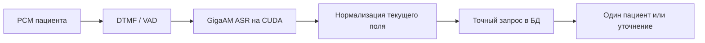

# Фамилия, дата рождения и номер карты

Телефон помогает найти карточку, но не подтверждает личность. Для неизвестного входящего номера сценарий сначала спрашивает «Вы у нас впервые?». Если номер известен, `inbound.id_birth_check` принимает дату рождения голосом или восемь цифр клавишами. Контекст поля передаётся из текущего состояния Rust: произнесённое «пятого мая тысяча девятьсот девяностого года» становится `05051990`, а не желаемым днём приёма в будущем году.



[identity.py](../../runtime/src/clinic/identity.py) — отдельный модуль нормализации и внутренней операции CRM `identity.lookup`. Он использует фиксированные запросы с параметрами. Фамилии и телефоны сами по себе возвращают только необходимость уточнения; полный номер карты или СНИЛС должен совпадать со всеми остальными переданными полями. Уже закреплённый пациент не может незаметно смениться. Контрольная сумма СНИЛС здесь не проверяется: модуль сообщает это явно и ищет точное значение в базе.

Различия `ё/е`, апострофов и дефиса/пробела нормализуются. Иностранное написание связывается с русским произношением только через отдельно утверждённые варианты в `identity_name_aliases`. Модуль чтения не создаёт эту таблицу и не утверждает варианты сам. Автоматического нечёткого выбора пациента нет. Однофамильцы, ошибка ASR или конфликт карты с телефоном требуют повторного полного идентификатора либо человека.

В локальном корпусе используются исключительно вымышленные пациенты. Полный прогон:

```bash
./clinic start --gpu --no-build
python debug/run_identity_speech.py --output debug/runs/identity-module/release
```

Фактические записи и ошибки сохраняются в `result.json` и `audio/*.wav`. Синтез выполняет Silero MIT CIS с явно проверенным произношением фамилий; ASR получает только PCM, без ожидаемого текста. Корпус отдельно проверяет настоящий CUDA-провайдер и выполнение нейронных операций.

| Вход | Фактическое распознавание | Результат |
|---|---|---|
| Шварценеггер | «Шварценеггер» | Точное совпадение с картой |
| Хачатурян | «Хачатурян» | Точное совпадение с картой |
| O’Connor, произношение «О Коннор» | «Аконнер» | Уточнение; полный номер карты произнесён заново |
| Петрова-Смирнова | «Петрова, Смирнова» | Составная фамилия нормализована, карта совпала |
| Пятое мая 1990 года | «5 мая 1990 года» | `1990-05-05`, полный год сохранён |
| Ноль, один, ноль, ноль, три | «Ноль один ноль ноль три» | Карта `01003`, начальный ноль сохранён |

Седьмой случай проходит через работающий Rust: выбор записи и себя двумя настоящими PCM-тонами, дата рождения 23.11.1992 — настоящей речью через телефонный VAD и ASR. После совпадения сценарий переходит к каталогу услуг. Снимки CRM до и после идентификации должны совпадать: запись на приём и СМС на этом шаге запрещены.

Это семь проверок поведения, включая уточнение ошибочно распознанной фамилии. Результат не означает семь правильных распознаваний с первой попытки, проверенную естественность голоса или качество на реальных пациентах. Первые неудачные попытки остаются в `debug/runs/identity-module/`.
