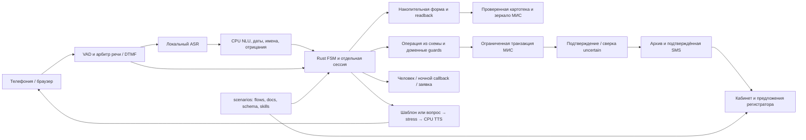

# Архитектура и условия следующей приёмки

Срез 22.10.2026. Основание — локальная история USER_MESSAGES.md, последующие прямые уточнения пользователя, [исходный регламент](../reference/reglament.txt), [индекс требований](../reference/docx_index.json), [контракт МИС](../mis/openapi.json). Последние уточнения пользователя имеют приоритет над старой документацией.

Представленная автоматическая оценка — 24.46 из 25 автоматических баллов, дефицит 0.54. Из этих описаний нельзя вывести гарантированный путь к 40/40: продуктовую оценку выставляет жюри. Практическая цель — закрыть подтверждённые пробелы сценариев и воспроизводимость, сохранив честный CI.

## Архитектура

Каждый модуль имеет ограниченную очередь, workers и timeout. Общий бюджет turn — 55с с учётом всех модулей и очередей. Разговоры не используют общий глобальный lock формы; записи имеют отдельную короткую защиту и idempotency. Внешний лимит МИС не отменяется параллельностью20 звонков: чтения используют актуальное зеркало, превышение бюджета выдаёт отдельный busy.

Распределение задач строгое. FSM задаёт состояние, права и подтверждения. Детерминированный parser и малый локальный encoder извлекают поля и помогают сформировать запрос по схеме; текущий E5 нельзя называть дообученной USER-bge без весов и независимой оценки. Простое пропущенное отчество уточняется локально. Неоднозначное имя/ё может потребовать ограниченной LLM, но только по буквальным свидетельствам и с видимым подтверждением. Reasoning нужен для сложного производственного восстановления ночью; текущий opt-in callable ещё не подключён к production API. В Actions внешние генеративные модели отключены.

ФИО пациента подтверждается до доверенного lookup/действий. `ё` хранится буквально; эквивалентность `е/ё` служит поиску кандидатов и не разрешает молчаливую замену личности. ФИО врачей заранее записываются полным снимком справочника; изменения модели, голоса, normalizer/stress или справочника меняют cache. Озвучка — CPU Silero MIT и context silero-stress. ASR в локальном нагрузочном профиле действительно выполняется на CUDA.

В предоставленной МИС нет направлений и срока действия. При необходимости это отдельный локальный реестр клиники с явным источником/актуальностью; отсутствие записи МИС ничего не подтверждает. Кабинет выписки и анализы до терапевта — предлагаемое расширение с правилами клиники, не реализованный endpoint и не назначение по совету ChatGPT.

## Модули и необходимые проверки

| Модуль | Что уже проверено в этом этапе | Что ещё обязательно проверить/исправить |
|---|---|---|
| Телефония и endpoint | Независимые речь/DTMF/mixed; таймер ответа после playback уже имеет Rust tests | Шум, всплески, тихая речь, длинные фразы, реальный endpoint→готовый ответ20 SIP звонков; finished PCM нагрузка это не заменяет |
| ASR/NLU | Frozen18 WAV, четыре голоса и 0.75–2.5; actual CUDA ASR20 calls; исправлена коллизия «переключите/перекос» | Строгое текстовое сравнение корпуса пока15/18; отдельно сопоставить доменные значения числовых форм и реальные переходы каждого исходного кейса |
| Идентификация | ФИО+DOB одной фразой, недостающее отчество, полный год, readback, неоднозначные кандидаты,ё; проверены CRM и compiled FSM | Новые сложные/иностранные ФИО и весь живой путь, исправления данных после выбора слота, отдельная политика отсутствующей карточки |
| Автомат и scheduler |28 Rust tests в act;20 correlated HTTP sessions; общий deadline; входы формы не обходят initialization | Все205 исходных примеров и все требуемые конечные состояния; незавершённый DOCX coverage gate остаётся красным |
| Конструктор и транзакции |12 операций по реальному OpenAPI, offline draft без authorization; uncertain не повторяется новым key/слотом | Сверка с настоящими ответами read-only стенда, изменения зеркала/срок актуальности, восстановление после crash между фазами |
| Дубликаты записи | Будущий визит той же специальности, явный keep/cancel/move/allow-new; consent связан со снимком | Полные звуковые диалоги каждого решения и гонки до подтверждения; существующая запись должна сохраниться при отказе/ошибке |
| Ночное восстановление | Отличены ошибки формы, busy и runtime МИС; callback10–16 с календарём; заявка без звонка и преждевременной SMS | Реальный reasoning provider с ограниченным контекстом/инструментами, сценарий уточнения и проверенного продолжения; собственная очередь обработки заявок сотрудником |
| TTS и врачебный банк | Реальный context silero-stress; reuse/invalidation полного справочника; audible native/phone WAV | Прослушивание естественности и ударений по согласованной рубрике; импорт справочника через все источники, а не только CRM.pull |
| Архив и кабинет | Реальный ASR/FSM архив из20audio прогона отображён Chromium без подмены transcript/trace; admin restore и line-scoped предложения | UI33d41a8 объединён, пройдены Chromium и visual-editor act; остаётся полный живой SIP/микрофонный путь с новым клиентом |
| Доказательства CI | Свежесть/SHA/XML, запрет внешних контрактных соединений, actual act; новый real20audio workflow | Завершить CPU job на GitHub hosted runner, устранить причины красного DOCX workflow; не переносить зелёные отчёты старого SHA |

## Приоритеты и критерии завершения

1. **P0 — регламент/DOCX.** Для каждого обязательного примера есть независимые ожидаемые поля, операция и конечное состояние; реальные исполнения всех нужных модулей подтверждены одним run_id/SHA. Coverage gate проходит без skip/xfail и без выдуманного evidence. Проверять сначала опубликованный failed workflow и конкретный провал, затем соответствующий модуль.
2. **P0 — реальная граница речи.** Для20 одновременных SIP/AudioSocket сессий шум не создаёт turn, речь не режется ошибочно, время после последнего значимого speech frame до готового ответа <60с у каждой реплики. Отдельно записаны endpoint delay и очередь/ASR/TTS.
3. **P1 — полные доменные развилки.** Запись, перенос, отмена, existing appointment и ночной сбой проходят реальным звуком до независимых целей. После uncertainty нет второго POST; отказ от callback сохраняет заявку и контекст без визита/SMS.
4. **P1 — завершать сквозные проверки объединённого UI.** UI33d41a8 влит; act/browser прошли, админский редактор сохранён. Панель реального ответа справа по умолчанию; каждое значение копируется; знания читаются из того же scenarios pack.
5. **P2 — reasoning и модель.** Настроенный production provider, timeout и бюджет, запрет инструментов записи/повтора uncertainty; обучение малой модели только с provenance и независимым holdout. Метрики encoder не заменяют метрики звонков.

По прямому уточнению пользователя работать последовательно: основной интегратор пишет тесты и завершает готовые ветки, не более одного активного агента. Проверенные модули — подписанный commit и remote push; незавершённое и не прошедшее сохраняется в TODO. Условия нагрузки и команды: [CONCURRENT_CALLS.md](CONCURRENT_CALLS.md).

## Уточнения и запуск —23.10.2026

[LLM_CLARIFICATION.md](LLM_CLARIFICATION.md) описывает подключённую локальную LLM, сверку ФИО с владельцем номера, FSM-переходы для непонятного времени, отдельное подтверждение и границы приёмки. Настоящие API-ответы и FSM→HTTP→LLM проверены; живой внешний провайдер ждёт локального ключа. GPU-аудиобанк46/46, запуск восстановлен; общий CI и оставшиеся исходные сценарии не объявляются закрытыми.
