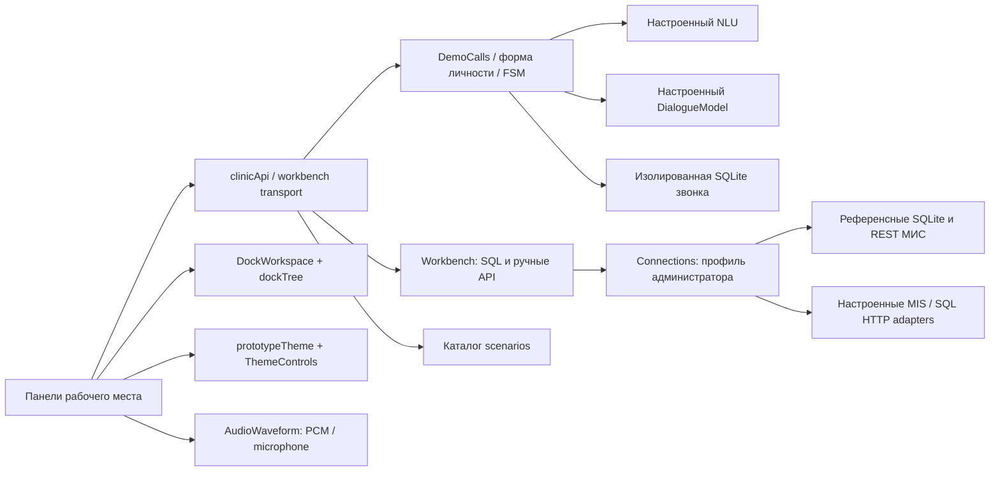

# Рабочее место: интерфейс, адаптеры, источники и доказательства

Обновлено 25.10.2026. Канонический исходник оформления — пользовательский `adjust-web-page-styles (1).zip`, `index.html`. Это перенос компонентов в приложение, с серверными данными вместо демонстрационной JavaScript-картотеки. Административный редактор графа сохранён.

## Модульное деление

| Модуль | Ответственность и граница |
|---|---|
| `dockTree.js` / `DockWorkspace.jsx` | Дерево вложенных областей, вкладки, перенос, клавиатура, разделители, отдельные окна, пресеты. Состояние компонентов остаётся смонтированным при перемещении и скрытии: перестройка окна не завершает звонок. В localStorage только расположение, идентификаторы и размеры. |
| `prototypeTheme.js` / `ThemeControls.jsx` | Перенесённый движок палитр из ZIP, непрерывный ползунок, системная тема, сохранение предпочтений и коррекция контраста. Действует только на корень рабочего места. |
| `AudioWaveform.jsx` | Амплитуда декодированного настоящего аудио либо сигнал analyser микрофона, воспроизведение, перемотка, скорость. Случайные столбики и browser speech synthesis не используются. |
| `clinicApi.js` | Единый транспорт и таймауты. UI не знает файлов БД, адресов провайдеров или токенов. Базовый путь API можно задать через `window.CLINIC_CONFIG.apiBase`. |
| `RegistrarWorkshop.jsx` | Реестр независимых панелей: звонки, разговор, автомат, справка, предложения, МИС, ручные API, SQL. Данные и действия связывает с адаптерами, а не с координатами окон. |
| `ManualConsole.jsx` / `QueryInspector.jsx` | Выполнение ручных запросов и просмотр фактического журнала с представлениями Таблица/SQL/JSON. Копирование каждой ячейки, параметров и полного результата. |
| `workbench.py` / `ConnectionsPanel.jsx` | Хранение профиля, проверка контракта МИС, исполнение SQL, выбор референсного или HTTP адаптера. Изменение данных требует учётной записи сотрудника и отдельного подтверждения. |
| `demo_call.py` / `identity_form.py` | FSM и сбор данных независимо от UI. Ранние ФИО и дата рождения сохраняются; недостающие поля уточняются; поиск только после обязательных полей и readback. LLM не создаёт SQL, ID пациента или разрешение записи. |
| `DataSources` | Локальные файлы и HTTP/HTTPS источники расписания, событий и справки. Явная загрузка/проверка/атомарное применение; при отказе предыдущий снимок сохранён. |

## Подключения и референсы

`scenarios/mis/connections.defaults.json` содержит начальные ссылки. Настройки администратора сохраняются рядом с `modules.json` в `connections.json`; пароли и токены в них отсутствуют, только имя переменной ключа. Профиль обслуживает ручные SQL/API панели. Он не меняет изолированную базу пробных звонков и не переключает незаметно уже идущий телефонный звонок.

- МИС по умолчанию: серверная реализация контракта `app/mis/mock_stand.py`, ссылка `/api/workshop/reference-mis`.
- БД по умолчанию: настоящая SQLite тестовой картотеки, ссылка `/api/workshop/sql`. Seed-данные находятся в репозитории; GET показывает описание, POST выполняет запрос.
- Внешняя МИС: адаптер `http_mis`, настраиваемый базовый URL и серверная ссылка на ключ; только известные операции из OpenAPI. Один запрос, без автоматического повтора неопределённой записи.
- Внешняя БД: адаптер `http_sql` для SQL HTTP-шлюза. Запрос `{sql, params, confirm_write, read_only}`, ответ `{result, changed_rows, duration_ms}`. Шлюз должен обеспечивать собственную авторизацию, read-only соединение при `read_only=true` и лимиты. Нативный произвольный PostgreSQL/MySQL DSN этот адаптер не реализует.
- LLM: существующие настройки модулей (`local`, `compatible`, `openrouter`), произвольная модель диалогового локального API и настраиваемый URL. Локальный адрес local_base_url отделён от внешнего base_url; локальный провайдер игнорирует сохранённый адрес compatible. Адрес локальной модели передан редактору также в основном compose; внешний ключ хранится вне Git.
- Исходные CSV/XLSX кейса находятся в `reference-data/`, контрольные суммы в manifest. Новый редактор выбирает их из репозитория. Ранее сохранённые пользовательские адреса не перезаписываются. Это снимки; направлений и срока их действия в МИС они не добавляют.

Телефонный CRM сохраняет отдельный режим `APP_MODE` / `STAND_URL` и транзакционные ограничения. Полное объединение конфигурации production CRM с профилями ручной консоли требует отдельной миграции привязок ID и фиксации подключения на время звонка; сейчас это не объявляется выполненным.

## Почему прежние тесты пропустили отказ

Акустическое совпадение TTS→ASR не доказывает осмысленный следующий ответ. Старые тесты формы начинали с выбора врача и затем заполняли ФИО в ожидаемом состоянии. Browser fixtures подставляли ответы HTTP и проверяли отображение, копирование и архивные гонки. Они не покрывали строчное ФИО в начале разговора, реальную цепочку E5→FSM→SQL и доступность диалогового API из пересозданного контейнера.

Новый обязательный `debug/run_text_call_ci.mjs` запускает одноразовый настоящий редактор с E5 и SQLite и затем Chromium без `page.route`. TTS в этом текстовом CI отключён явно, генеративная LLM заблокирована режимом CI; это не аудио-приёмка. Проверяются:

1. `иванов петр иванович` первой фразой: сохранение данных, вопрос о цели, отсутствие преждевременного поиска.
2. Выбор терапевта, подтверждение, дата рождения и readback: точные состояния автомата.
3. Фактический параметризованный SQL и отсутствие записи, если совпадения нет. Пётр не подменяется Иваном.
4. Совпадение всех видимых реплик и сохранённого trace с backend.
5. Настоящие SQL/API запросы из самостоятельных панелей и сохранение темы.

`debug/run_recursive_dock.mjs` проверяет геометрию и жизненный цикл компонентов. `debug/run_registrar_mis_panel.mjs` сохраняет отдельные fixtures для clipboard и архивных гонок. `debug/run_registrar_scenario_actions.mjs` проверяет реальную Repository/Learning SQLite, очередь предложения, изоляцию линии, ACL и запрет неподтверждённого применения. Эти виды доказательств не заменяют друг друга.

## Выполненная приёмка и оставшиеся проверки

- PR #3 от clinch0 объединён: `fe0190e`, 73 локальных PR-проверки.
- Сохранение раннего ФИО и журнал модели: `6e684ca`; ранняя дата рождения: `72c946d`. E5/форма/модель —90 passed, дополнительно3 trace tests.
- Новый UI: Chromium18 проверок docking,23 панели/clipboard,8 Repository/Learning; полный visual-editor act прошёл, включая9 новых настоящих текстовых условий. Итоговый повтор act:50 server tests,18 docking,23 панели/clipboard,8 Repository/Learning,9 настоящих текстовых условий —passed.
- Живой локальный Docker-прогон без перехвата HTTP: `debug/runs/text-call-browser/`; Qwen действительно ответила (статус `responded`, request_sent=true), SQL вернул0 совпадений. Волна получена из фактической озвучки. Дополнительно debug/run_observer_call.mjs переиграл замороженный WAV через Chromium getUserMedia/AudioWorklet→CUDA ASR→E5→demo.confirm, затем DTMF→demo.identity_name;5 условий passed, SHA fixture проверен, генерации WAV нет. Штатный audio-check после обновления всех образов:exit0,46/46. Доступность физического микрофона и естественность голоса этим не доказаны.
- Нужны: отдельный полный audio→ASR→FSM браузерный путь записи с frozen corpus, производительность20 полных записей, физический микрофон, актуальная внешняя LLM/МИС проверка при настроенных ключах, миграция production профилей, устранение оставшихся DOCX/общего CI ошибок. Короткий operator→callback нагрузочный тест не считается20 полными записями.
